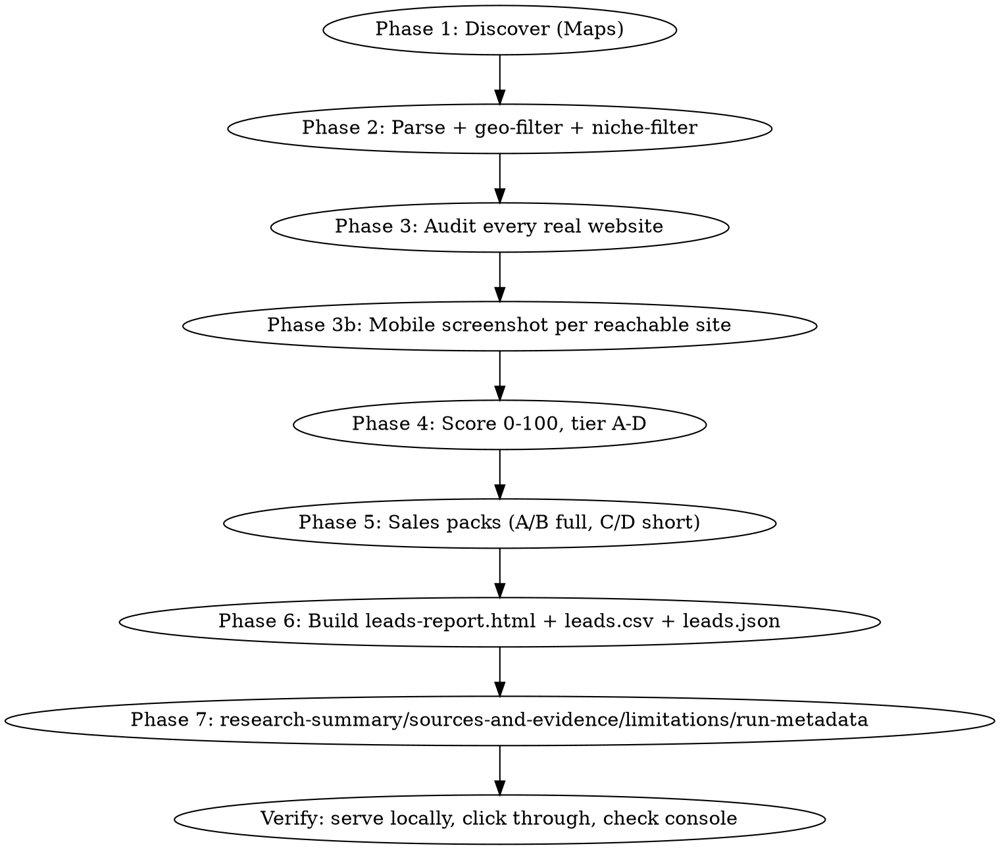

# Lead Hunter

Autonomous local-business lead-generation: discover real businesses in a niche+city via Google Maps (or Places API when a key exists — see `scripts/sources.py`), audit every real website they have with measured (not invented) data, score **two independent opportunities per lead** (software/digitization fit, and website quality — a weak website does not prove software need, and vice versa), and draft ready-to-review outreach (never auto-sent). Produces an interactive self-contained HTML report + CSV + JSON + research-summary/sources/limitations docs per run.

Two built-in verticals (`--vertical` on `build_sales_packs.py`): `b2b_software` (default — Egyptian manufacturers/distributors/logistics/field-service prospects for custom software & automation, see `references/industry-playbooks.md`) and `translation` (the original translation-office website-selling angle, kept verbatim). Both share the same discovery/audit/scoring/report engine.

## Hard rules (never violate)

1. **Never invent data.** Missing phone/email/rating/website → write `غير متوفر` (or `N/A`) and mark confidence low. Every number in a sales pack must trace to something actually measured or found.
2. **Never fabricate PageSpeed/Lighthouse scores.** Try the public PSI API (`https://www.googleapis.com/pagespeedonline/v5/runPagespeed?url=...&strategy=mobile`); it is commonly quota-blocked (HTTP 429) without a key. If blocked, say so explicitly and use `scripts/audit.py`'s real measured server-response-time instead — label it clearly as *not* a Lighthouse/mobile score.
3. **Never auto-send anything.** Only prepare WhatsApp `wa.me` links / email drafts for the user to review and send themselves.
4. **Public info only.** Business name, address, phone, website, public email/social links. Nothing personal beyond what the business itself publishes.
5. **Checkpoint after every phase** to the output directory so a crash or interruption never loses work. Print a one-line progress update per phase (don't ask the user to confirm mid-run).
6. **A business that's unreachable, wrong-city, or outside the niche is a recorded finding, never silently dropped.** Log exclusions to `excluded_non_<city>.json` / `excluded_not_niche.json` with a reason, same as the rest of this pipeline.
7. **A weak website is not evidence of an internal workflow problem.** `score.py`'s two scores are independent on purpose (see `tests/test_score.py`'s `TestDualScoreIndependence`). Never let a `software_fit` hypothesis get phrased as a verified fact — "ممكن"/"فرصة محتملة" language only, derived from an observed public signal (`audit.py`'s `b2b_signals` block), until confirmed in a discovery call.
8. **Never scrape behind an authwall or bypass CAPTCHAs/ToS** (LinkedIn profiles, paid directories, etc.). If a source needs that, it's not implemented — see `references/sources.md` — do a manual, low-volume lookup yourself instead of scripting around the restriction.
9. **Decision-maker fields (`decision_maker_name/title/source_url`) default to `null`/`unknown`.** Only fill them in after you've actually found and opened a real public source (a company's own "About"/"Team" page, an official press release) — never infer an email format or guess a name.

## Parameters

| Param | Default | Notes |
|---|---|---|
| `niche` | — (required) | e.g. `مكاتب الترجمة المعتمدة`, or one/more `references/industry-playbooks.md` categories (`manufacturing`, `distribution`, `logistics`, `field_service`, ...) |
| `city` / `places` | — (required) | one city, or a city + its districts/industrial zones, e.g. `الإسكندرية` + `برج العرب` + `دمنهور` |
| `country` | `مصر` | |
| `vertical` | `b2b_software` | or `translation` — see `build_sales_packs.py --vertical` |
| `service` | Rakmyat Solutions' bilingual AR/EN site w/ quote-form, file upload, SEO | what you're selling |
| `my_name` | مريم | used in message signatures — never the user's own name unless asked |
| `my_company` | Rakmyat Solutions | |
| `language` | Egyptian Arabic | outreach language/dialect |
| `max_leads` | all that exist (don't stop at 20) | |
| `output_dir` | `./lead-hunter-output/{niche}-{city}/` | |

## Workflow



### Phase 1 — Discover

Check `GOOGLE_PLACES_API_KEY` in env first. If present, use the Places API (Text Search + Place Details) — far cheaper than browser scraping. **If absent (the common case), drive Google Maps yourself with the Playwright browser tool** — do not scrape Google Search result pages (ToS). For each query variation (see `references/niche-queries.md` for how to generate them for a new niche):

1. `browser_navigate` to `https://www.google.com/maps/search/<url-encoded query>`
2. Run the scroll+extract snippet below via `browser_evaluate`, with `filename` set to save straight to `<output_dir>/raw/qNN_<slug>.json` (keeps huge result blobs out of your context):

```js
async () => {
  for (let w = 0; w < 10 && !document.querySelector('div[role="feed"]'); w++) {
    await new Promise(r => setTimeout(r, 500));
  }
  const feed = document.querySelector('div[role="feed"]');
  if (!feed) return {error: 'no feed found', title: document.title};
  let lastCount = 0, stableRounds = 0;
  for (let i = 0; i < 40; i++) {
    feed.scrollTop = feed.scrollHeight;
    await new Promise(r => setTimeout(r, 900));
    const count = feed.querySelectorAll('[role="article"]').length;
    if (count === lastCount) stableRounds++; else stableRounds = 0;
    lastCount = count;
    if (stableRounds >= 3) break;
  }
  const articles = Array.from(feed.querySelectorAll('[role="article"]'));
  return {
    query: document.title, feedCount: articles.length,
    results: articles.map(a => {
      const nameLink = a.querySelector('a[href*="/maps/place/"]');
      const siteLink = Array.from(a.querySelectorAll('a')).find(x =>
        /موقع|website|الإلكتروني/i.test(x.getAttribute('aria-label') || ''));
      return {
        name: nameLink ? nameLink.getAttribute('aria-label') : null,
        placeUrl: nameLink ? nameLink.href : null,
        website: siteLink ? siteLink.href : null,
        fullText: a.innerText,
      };
    }),
  };
}
```

Query plan: 3-4 generic queries (`"<niche> <city>"`, English equivalent, `"certified ... <city>"`-style variants) **plus one query per major district/neighborhood** of the city — sparse local results make Google Maps silently broaden the search radius to other cities/countries, which Phase 2's geo-filter catches, but more districts = better first-pass coverage. Keep going until 2-3 consecutive new queries add no new unique businesses.

### Phase 2 — Parse, dedupe, geo-filter, niche-filter

Run `scripts/discover.py --parse --output-dir <dir> --city-lat MIN,MAX --city-lng MIN,MAX --niche-keywords "kw1,kw2,..."`. This:
- Parses each raw query JSON's `fullText` into rating/reviews/category/address/phone/hours (regex, handles Arabic-Indic digits and both mobile 01X-XXXXXXXX and landline 0XX-XXXXXXX formats).
- Dedupes by the Maps CID embedded in `placeUrl` (`!19s...`), falling back to phone number.
- **Geo-validates**: extracts real lat/lng from `placeUrl` (`!3d...!4d...`) and drops anything outside the city's bounding box, logging it to `excluded_non_<city>.json` with a reason. District-name searches routinely pull in same-named branches from other cities — always run this filter, it is not optional.
- **Niche-validates**: drops businesses whose name/category contain none of the niche keywords (adapt per niche — see `references/niche-queries.md`), *unless* a known false-negative (transliterated name) — review the printed exclusion list once before trusting it blindly.
- Re-sequences lead IDs (`<CITYCODE>001`, `002`, ...) and writes `raw_businesses.json`.

**Screenshot filenames must key off the stable `lead_id` in the CURRENT `raw_businesses.json`, not a remembered one** — every filter pass re-sequences IDs. If you already screenshotted before a re-filter, re-map by website domain (see `scripts/discover.py --remap-screenshots`) rather than re-screenshotting.

### Phase 3 — Audit every real website

Run `scripts/audit.py --output-dir <dir>`. For every business with `has_website: true`, this does a real HTTP fetch (with an http:// fallback) and measures: HTTPS validity + mixed content, mobile viewport meta tag, Arabic+English content presence, quote/contact form + file-upload field presence, WhatsApp/tel link presence, title/meta-description genericness, H1 count, structured data, `/sitemap.xml` presence, copyright year, platform (WordPress/Wix/Shopify/Squarespace/Webflow/custom), and **real server response time** (not a substitute for Lighthouse — say so in the report). Unreachable sites are recorded with the error, not skipped.

Then, for every `reachable: true` site, take one mobile screenshot yourself: set viewport to 390x844 once, then for each site `browser_navigate` + `browser_take_screenshot` (filename `<output_dir>/screenshots/<lead_id>.png`). Two sites returning a Cloudflare "checking your browser" interstitial on the first load is common — retry once before recording it as a finding.

### Phase 4 — Score (two independent scores)

Run `scripts/score.py --output-dir <dir>`. Produces, per lead:
- `score_software_fit` (0-100): operational complexity (0-25, from `audit.py`'s `b2b_signals` — branches/warehouse/dealer/portal language) + workflow relevance (0-25) + business scale from review count as a proxy (0-15) + growth/hiring signal (0-10, careers-page tech keywords) + contact accessibility (0-10) + evidence quality/corroboration (0-10).
- `score_website_opportunity` (0-100): availability (0-20) + mobile usability (0-15) + core functionality gaps (0-20) + missing B2B/customer capability (0-20) + business relevance (0-15) + contact accessibility (0-10).
- Each component ships with a one-line human-readable reason (`score_software_fit_reasons`, `score_website_opportunity_reasons`) — the report shows these verbatim, never just the number.
- Tiers (same thresholds both scores): A 80+, B 65-79, C 45-64, D <45.
- `total_score`/`tier` are kept for v1 compatibility (= the higher of the two scores) so an old report template or CSV consumer doesn't break.

**Edit the component weights/signals directly in `score.py`** for a different market — the two-score *structure* is what should stay fixed, not the numbers.

### Phase 5 — Sales packs

Run `scripts/build_sales_packs.py --output-dir <dir> --vertical b2b_software --service "..." --my-name "..." --my-company "..." --my-phone "..." --my-email "..."`. For `b2b_software` (default), every "opportunity" is a **hypothesis derived from an observed `b2b_signals` flag** (multi-branch, warehouse, dealer/distributor language, an unanswered quote-request pattern, tech hiring on the careers page) — phrased with "ممكن"/"فرصة محتملة", never asserted as a confirmed internal problem. Produces, per lead: 2-line summary, up to 3 opportunity hypotheses, `evidence_gaps` (what's still unknown), `likely_buyer_role`, business impact framed as hypothetical, a WhatsApp opener (≤5 lines, no price, ends with an offer to talk), an email, 3 follow-ups, a call opener + 3 objections, 5 discovery questions, and a price range that **falls back to "يتطلب تحديد عبر مكالمة اكتشاف" (requires a discovery call)** whenever there's no clear scale signal to justify a number — never a guessed price. Pass `--vertical translation` to get the original translation-office website-selling templates verbatim instead.

### Phase 6 — Report

Run `scripts/build_report.py --output-dir <dir> --page-title "..." --h1 "..."`. Produces ONE self-contained `leads-report.html` (own `<!DOCTYPE>`/`<head>` with `<meta charset="UTF-8">` — do not skip this, Arabic renders as mojibake without it when the file is opened directly or served without a charset header) with: RTL layout, summary cards (now including leads-with-phone / leads-with-decision-maker counts), sortable/filterable table with **two separate score+tier columns** (software-fit, website-opportunity — filter matches either), click-row detail panel (both score breakdowns with their per-component reasons, audit findings including the `b2b_signals` block, screenshot, likely buyer role, evidence gaps, discovery questions, every drafted message with a copy button, a `wa.me` link that **opens** WhatsApp pre-filled, never sends), a status dropdown + notes field persisted to `localStorage` (wrapped in try/catch), and CSV/JSON export of the current filtered view. Also writes `leads.csv` and `leads.json` next to it.

### Phase 7 — Research documentation

Run `scripts/build_research_docs.py --output-dir <dir> --run-label "..." --queries-run N --sources-attempted "google_maps_browser,google_places_api" --target-count N`. Writes `run-metadata.json` (every count derived from what's actually on disk — never a fixed checklist), `research-summary.md`, `sources-and-evidence.md`, and `limitations.md`. If the target lead count wasn't met, this reports the real number and `target_met: false` — never pads the dataset to look exhaustive.

### Verify before reporting done

Serve the folder locally (`python -m http.server` — **never `file://`**, Playwright's sandbox blocks it and some browsers mis-detect encoding over `file://` too) and load it with the Playwright browser tool. Click a row, confirm the detail panel renders real data, run the search box, change a status and confirm `localStorage.getItem('lh_status')` picked it up, check console for errors. Fix anything broken before telling the user it's done.

## Testing

`tests/` has a real, network-free `unittest` suite (query generation, Maps-text parsing/dedup regressions, score boundaries, and — most importantly — `TestDualScoreIndependence`, which guards the core design invariant that a bad website must not inflate the software-fit score). Run it before and after any change to `discover.py`/`score.py`/`query_templates.py`:

```
cd ~/.claude/skills/lead-hunter && python -m unittest discover -s tests -v
```

Never claim "tests pass" without actually running this and reading the output.

## Sources

See `references/sources.md` for exactly which discovery sources are available in a given environment (Maps browser-driven: always; Places API: only with a key; LinkedIn/directories: not implemented, manual-only) and `scripts/sources.py` for the adapter interface if you need to add a new, ToS-checked source.

## Final summary to give the user

Counts (imported → geo-valid → niche-valid → has-website → reachable → screenshotted → with-phone → with-decision-maker), tier distribution **for both scores**, top 10 by software-fit score with their evidence, anything unreachable/excluded and why, what couldn't be verified (PSI status, LinkedIn/directory sources not attempted, any manual-review flags), and whether the target lead count was actually met (`run-metadata.json`'s `target_met`).

## Adapting to a new niche

State what you adapted, explicitly, e.g.: *"For law firms, swapped the 'quote form' check for a 'book a consultation' link/button detector, and the WhatsApp-opener templates now reference consultation booking instead of translation turnaround."* Add a new entry to `references/industry-playbooks.md` and `scripts/query_templates.py`'s `PLAYBOOKS` dict, edit `scripts/audit.py`'s `b2b_signals` keyword lists and `scripts/build_sales_packs.py`'s hypothesis templates — the scoring *structure* (two independent scores) and report template stay the same.
