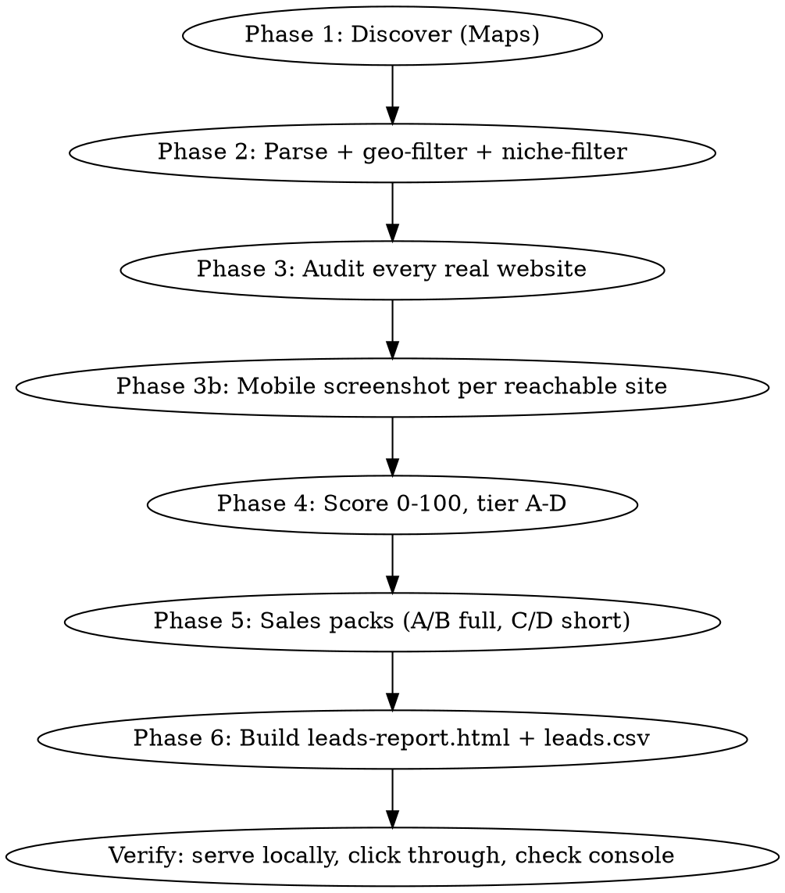

# Lead Hunter

Autonomous local-business lead-generation: discover real businesses in a niche+city via Google Maps, audit every real website they have with measured (not invented) data, score opportunity 0-100, and draft ready-to-review outreach (never auto-sent). Produces an interactive self-contained HTML report + CSV + JSON per run.

## Hard rules (never violate)

1. **Never invent data.** Missing phone/email/rating/website → write `غير متوفر` (or `N/A`) and mark confidence low. Every number in a sales pack must trace to something actually measured or found.
2. **Never fabricate PageSpeed/Lighthouse scores.** Try the public PSI API (`https://www.googleapis.com/pagespeedonline/v5/runPagespeed?url=...&strategy=mobile`); it is commonly quota-blocked (HTTP 429) without a key. If blocked, say so explicitly and use `scripts/audit.py`'s real measured server-response-time instead — label it clearly as *not* a Lighthouse/mobile score.
3. **Never auto-send anything.** Only prepare WhatsApp `wa.me` links / email drafts for the user to review and send themselves.
4. **Public info only.** Business name, address, phone, website, public email/social links. Nothing personal beyond what the business itself publishes.
5. **Checkpoint after every phase** to the output directory so a crash or interruption never loses work. Print a one-line progress update per phase (don't ask the user to confirm mid-run).
6. **A business that's unreachable, wrong-city, or outside the niche is a recorded finding, never silently dropped.** Log exclusions to `excluded_non_<city>.json` / `excluded_not_niche.json` with a reason, same as the rest of this pipeline.

## Parameters

| Param | Default | Notes |
|---|---|---|
| `niche` | — (required) | e.g. `مكاتب الترجمة المعتمدة`, `مكاتب محاماة`, `عيادات أسنان` |
| `city` | — (required) | e.g. `الإسكندرية` |
| `country` | `مصر` | |
| `service` | Rakmyat Solutions' bilingual AR/EN site w/ quote-form, file upload, SEO | what you're selling |
| `my_name` | مريم | used in message signatures — never the user's own name unless asked |
| `my_company` | Rakmyat Solutions | |
| `language` | Egyptian Arabic | outreach language/dialect |
| `max_leads` | all that exist (don't stop at 20) | |
| `output_dir` | `./lead-hunter-output/{niche}-{city}/` | |

## Workflow



### Phase 1 — Discover

Check `GOOGLE_PLACES_API_KEY` in env first. If present, use the Places API (Text Search + Place Details) — far cheaper than browser scraping. **If absent (the common case), drive Google Maps yourself with the Playwright browser tool** — do not scrape Google Search result pages (ToS). For each query variation (see `references/niche-queries.md` for how to generate them for a new niche):

1. `browser_navigate` to `https://www.google.com/maps/search/<url-encoded query>`
2. Run the scroll+extract snippet below via `browser_evaluate`, with `filename` set to save straight to `<output_dir>/raw/qNN_<slug>.json` (keeps huge result blobs out of your context):

```js
async () => {
  for (let w = 0; w < 10 && !document.querySelector('div[role="feed"]'); w++) {
    await new Promise(r => setTimeout(r, 500));
  }
  const feed = document.querySelector('div[role="feed"]');
  if (!feed) return {error: 'no feed found', title: document.title};
  let lastCount = 0, stableRounds = 0;
  for (let i = 0; i < 40; i++) {
    feed.scrollTop = feed.scrollHeight;
    await new Promise(r => setTimeout(r, 900));
    const count = feed.querySelectorAll('[role="article"]').length;
    if (count === lastCount) stableRounds++; else stableRounds = 0;
    lastCount = count;
    if (stableRounds >= 3) break;
  }
  const articles = Array.from(feed.querySelectorAll('[role="article"]'));
  return {
    query: document.title, feedCount: articles.length,
    results: articles.map(a => {
      const nameLink = a.querySelector('a[href*="/maps/place/"]');
      const siteLink = Array.from(a.querySelectorAll('a')).find(x =>
        /موقع|website|الإلكتروني/i.test(x.getAttribute('aria-label') || ''));
      return {
        name: nameLink ? nameLink.getAttribute('aria-label') : null,
        placeUrl: nameLink ? nameLink.href : null,
        website: siteLink ? siteLink.href : null,
        fullText: a.innerText,
      };
    }),
  };
}
```

Query plan: 3-4 generic queries (`"<niche> <city>"`, English equivalent, `"certified ... <city>"`-style variants) **plus one query per major district/neighborhood** of the city — sparse local results make Google Maps silently broaden the search radius to other cities/countries, which Phase 2's geo-filter catches, but more districts = better first-pass coverage. Keep going until 2-3 consecutive new queries add no new unique businesses.

### Phase 2 — Parse, dedupe, geo-filter, niche-filter

Run `scripts/discover.py --parse --output-dir <dir> --city-lat MIN,MAX --city-lng MIN,MAX --niche-keywords "kw1,kw2,..."`. This:
- Parses each raw query JSON's `fullText` into rating/reviews/category/address/phone/hours (regex, handles Arabic-Indic digits and both mobile 01X-XXXXXXXX and landline 0XX-XXXXXXX formats).
- Dedupes by the Maps CID embedded in `placeUrl` (`!19s...`), falling back to phone number.
- **Geo-validates**: extracts real lat/lng from `placeUrl` (`!3d...!4d...`) and drops anything outside the city's bounding box, logging it to `excluded_non_<city>.json` with a reason. District-name searches routinely pull in same-named branches from other cities — always run this filter, it is not optional.
- **Niche-validates**: drops businesses whose name/category contain none of the niche keywords (adapt per niche — see `references/niche-queries.md`), *unless* a known false-negative (transliterated name) — review the printed exclusion list once before trusting it blindly.
- Re-sequences lead IDs (`<CITYCODE>001`, `002`, ...) and writes `raw_businesses.json`.

**Screenshot filenames must key off the stable `lead_id` in the CURRENT `raw_businesses.json`, not a remembered one** — every filter pass re-sequences IDs. If you already screenshotted before a re-filter, re-map by website domain (see `scripts/discover.py --remap-screenshots`) rather than re-screenshotting.

### Phase 3 — Audit every real website

Run `scripts/audit.py --output-dir <dir>`. For every business with `has_website: true`, this does a real HTTP fetch (with an http:// fallback) and measures: HTTPS validity + mixed content, mobile viewport meta tag, Arabic+English content presence, quote/contact form + file-upload field presence, WhatsApp/tel link presence, title/meta-description genericness, H1 count, structured data, `/sitemap.xml` presence, copyright year, platform (WordPress/Wix/Shopify/Squarespace/Webflow/custom), and **real server response time** (not a substitute for Lighthouse — say so in the report). Unreachable sites are recorded with the error, not skipped.

Then, for every `reachable: true` site, take one mobile screenshot yourself: set viewport to 390x844 once, then for each site `browser_navigate` + `browser_take_screenshot` (filename `<output_dir>/screenshots/<lead_id>.png`). Two sites returning a Cloudflare "checking your browser" interstitial on the first load is common — retry once before recording it as a finding.

### Phase 4 — Score

Run `scripts/score.py --output-dir <dir>`. Implements the exact rubric: business strength (reviews 0-20, rating≥4.0 → 10, contactable → 10, max 40) + website weakness (no site → 50; else slow response/no mobile tag/not bilingual/no quote form/no WhatsApp/no HTTPS/outdated copyright year, max 50) + contactability folded into strength. Tiers: A 75+, B 55-74, C 35-54, D <35. **Edit the weights directly in the script** for a new niche (e.g. law firms: swap "quote form" for "book a consultation" link detection) — the rubric is meant to be edited, not treated as fixed.

### Phase 5 — Sales packs

Run `scripts/build_sales_packs.py --output-dir <dir> --service "..." --my-name "..." --language "Egyptian Arabic"`. Produces, per lead: 2-line summary, top-3 problems (real numbers inserted), plain-language business impact, a WhatsApp opener (≤5 lines, one real finding, no price, ends with a free-audit offer), an email (subject+body), 3 follow-ups (day 3 / day 7 adds something new / day 14 polite last one), a call opener + 3 objections with answers, a recommended package + EGP price range scaled by review count, and best channel/time. The opener is selected from the single most severe real finding per lead (no website > unreachable > slow > not bilingual > no WhatsApp > no quote form > generic polish) — this is what keeps 50+ packs from reading identically; review a sample before sending anything.

### Phase 6 — Report

Run `scripts/build_report.py --output-dir <dir> --title "..."`. Produces ONE self-contained `leads-report.html` (own `<!DOCTYPE>`/`<head>` with `<meta charset="UTF-8">` — do not skip this, Arabic renders as mojibake without it when the file is opened directly or served without a charset header) with: RTL layout, summary cards, sortable/filterable table (tier/website/status/text search), click-row detail panel (score breakdown, audit findings, screenshot, every drafted message with a copy button, a `wa.me` link that **opens** WhatsApp pre-filled, never sends), a status dropdown + notes field persisted to `localStorage` (wrapped in try/catch), and CSV/JSON export of the current filtered view. Also writes `leads.csv` next to it.

### Verify before reporting done

Serve the folder locally (`python -m http.server` — **never `file://`**, Playwright's sandbox blocks it and some browsers mis-detect encoding over `file://` too) and load it with the Playwright browser tool. Click a row, confirm the detail panel renders real data, run the search box, change a status and confirm `localStorage.getItem('lh_status')` picked it up, check console for errors. Fix anything broken before telling the user it's done.

## Final summary to give the user

Counts (imported → geo-valid → niche-valid → has-website → reachable → screenshotted), tier distribution, top 10 by score, anything unreachable/excluded and why, what couldn't be verified (PSI status, any manual-review flags).

## Adapting to a new niche

State what you adapted, explicitly, e.g.: *"For law firms, swapped the 'quote form' check for a 'book a consultation' link/button detector, and the WhatsApp-opener templates now reference consultation booking instead of translation turnaround."* Edit `scripts/audit.py`'s niche-specific checks and `scripts/build_sales_packs.py`'s problem/impact templates — the scoring weights and report template stay the same.
